<a href="https://recompstore.com/dev/miguel0827"><picture><source media="(prefers-color-scheme: dark)" srcset="https://recompstore.com/assets/press/verified-light.svg"></picture></a>

### Hey, I'm NyxBorn (Miguel Ángel)

I write code for the web, I'm making a game of my own, and I make native PC ports of PS2 games.

Right now I'm working on **Sigacon**, an accounting web app (TypeScript and Docker). My thesis is **[Apolo](https://github.com/JuanManuelBR/Apolo)**, an online exam platform that won't let you open AI tools, browser extensions or shortcuts in the middle of a test.

#### My game

An endless voxel world, built with Godot and Rust. That's all I can say for now.

#### PS2 on PC

My first release is **[Crash Tag Team Racing PC](https://github.com/Miguel0827/Crash-Tag-Team-Racing-PC)**: the game recompiled into a real Windows program, built from your own disc.

<a href="https://recomplauncher.com/game/crash-tag-team-racing-pc"><picture><source media="(prefers-color-scheme: dark)" srcset="https://recomplauncher.com/assets/press/launcher/badge-light.svg"></picture></a>

Next on my list:

#### Tools

<picture>
<source media="(prefers-color-scheme: dark)" srcset="https://raw.githubusercontent.com/Miguel0827/Miguel0827/output/github-snake-dark.svg">

</picture>

If you like what I do, you can support me here 💜

<b>En español</b>

### Hola, soy NyxBorn (Miguel Ángel)

Programo para la web, estoy haciendo un juego propio y hago ports nativos para PC de juegos de PS2.

Ahora mismo trabajo en **Sigacon**, un aplicativo contable web (TypeScript y Docker). Mi tesis es **[Apolo](https://github.com/JuanManuelBR/Apolo)**, una plataforma de exámenes en línea que no te deja abrir herramientas de IA, extensiones ni atajos en pleno examen.

**Mi juego** (en construcción): un mundo voxel sin límites, hecho con Godot y Rust. Por ahora no puedo contar más.

**PS2 en PC**: mi primer lanzamiento es **[Crash Tag Team Racing PC](https://github.com/Miguel0827/Crash-Tag-Team-Racing-PC)**, el juego recompilado como un programa de Windows de verdad, a partir de tu propio disco.

Lo siguiente en mi lista: Crash Bandicoot: La Venganza de Cortex, Ratatouille, WALL-E, PES 2014 y juego en línea para Crash Nitro Kart.

Si te gusta lo que hago, puedes apoyarme en [GitHub Sponsors](https://github.com/sponsors/Miguel0827) 💜

